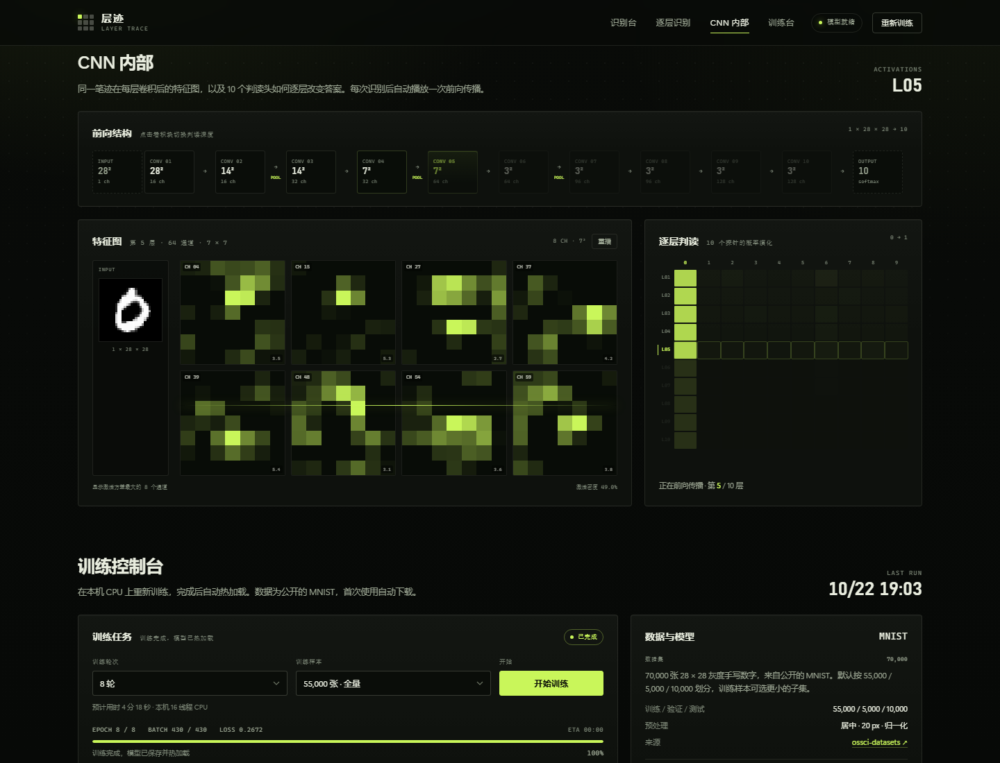
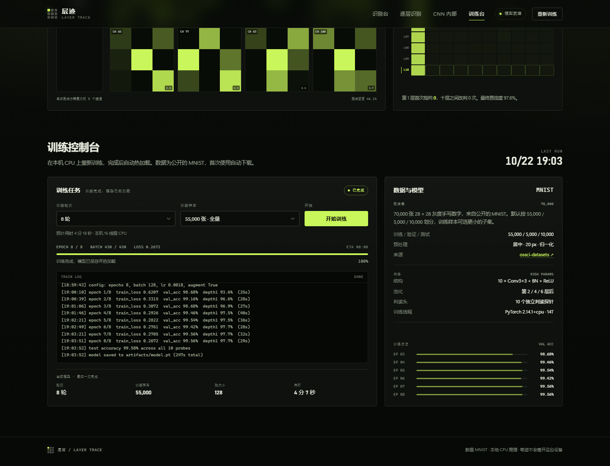

# 层迹 / Layer Trace

一个本地运行的 CNN 手写数字识别实验台：10 层卷积，每一层后面都接一个独立判读头。写一个数字，拖动深度滑杆，就能看到同一笔迹在第 1 层到第 10 层卷积后的判读结果，以及每一层在 MNIST 测试集上的识别率。

## 它有什么

- **10 层卷积网络**：`Conv3×3 + BatchNorm + ReLU` 重复 10 次，第 2 / 4 / 6 层后做 2×2 最大池化。
- **逐层独立判读**：每个卷积层后接一个轻量探针（自适应池化 + 两层 MLP），一次前向传播返回 10 个深度的概率分布。
- **可选择卷积层数**：深度滑杆、层卡片、准确率曲线上的数据点，三处都可以切换 1 到 10 层。
- **逐层识别率**：训练结束后在 10,000 张测试集上分别评估 10 个探针，给出准确率、增量、混淆矩阵和推荐深度。
- **CNN 内部可视化**：前向结构图、每层激活方差最大的 8 个特征图、10 个探针的逐层概率热力图。
- **前向传播动画**：每次识别后从第 1 层自动播放到所选深度，深度滑杆、特征图、概率和判读结果同步变化，可随时重播。
- **真实样本**：页面内置 12 张 MNIST 测试图，点击即可载入并观察不同深度的判读。
- **浏览器训练**：可以选择训练轮次和样本量，在本机 CPU 上重新训练，完成后模型自动热加载。
- **本地优先**：FastAPI + 原生 HTML/CSS/JS，没有前端构建步骤，笔迹只在内存和本机之间流转。

## 预览






## 快速开始

仓库包含训练好的模型、对应指标和预览截图，不包含本地 Python 虚拟环境与 MNIST 原始数据。安装 Python 3.10+ 后，在 Windows PowerShell 中进入项目目录运行：

```powershell
.\run.ps1
```

首次运行会创建 `.venv` 并安装依赖；如果模型不存在，会先下载 MNIST 并训练。服务启动时会自动补齐 MNIST 数据，然后在 <http://127.0.0.1:8000> 提供页面。首次安装与数据下载需要联网；后续运行使用本地文件。

若 PowerShell 的脚本执行策略阻止启动，可使用下方逐条命令完成安装与启动。依赖安装时间取决于网络，重新训练的耗时与 CPU、线程数、样本量和轮次有关。

如果要从零开始（Python 3.10+，Windows PowerShell）：

```powershell
python -m venv .venv
.\.venv\Scripts\python.exe -m pip install -r requirements.txt
.\.venv\Scripts\python.exe -m app.mnist
.\.venv\Scripts\python.exe -m app.train --epochs 8 --train-size 55000
.\.venv\Scripts\python.exe -m uvicorn app.main:app --host 127.0.0.1 --port 8000
```

`requirements.txt` 已包含 CPU 版 PyTorch 的索引地址。

训练参数：

| 参数 | 默认值 | 说明 |
| --- | --- | --- |
| `--epochs` | 8 | 训练轮次 |
| `--train-size` | 55000 | 从 55,000 张训练池中抽取的样本数 |
| `--batch-size` | 128 | 批大小 |
| `--lr` | 0.0018 | AdamW 学习率，余弦退火 |
| `--aux-weight` | 0.3 | 9 个辅助探针的损失权重 |
| `--threads` | 0 | 自动选择 CPU 线程数，上限 16；可手动指定 |

## 逐层识别率是怎么来的

模型在训练时计算 10 个分类损失：第 10 层主判读头，加上前 9 层的辅助判读头。总损失为主头损失加上 `--aux-weight` 乘以 9 个辅助损失的均值。所有探针共享同一套卷积特征，因此一次训练就得到 10 个深度的分类器，不需要训练 10 个独立网络。

```
输入 28×28
  └─ Conv1 ─ probe1
     Conv2 ─ pool ─ probe2
     Conv3 ─ probe3
     Conv4 ─ pool ─ probe4
     Conv5 ─ probe5
     Conv6 ─ pool ─ probe6
     Conv7 ─ probe7
     Conv8 ─ probe8
     Conv9 ─ probe9
     Conv10 ─ probe10（主输出）
```

探针本身不含卷积，所以“10 层卷积”是字面意义上的 10 个卷积层。深度 `n` 的判读结果只使用前 `n` 层卷积的输出。

## 目录

```
run.ps1          一键启动
requirements.txt 依赖清单
app/
  main.py        FastAPI 服务、推理、训练进程管理
  model.py       10 层 CNN 与 10 个逐层探针
  train.py       训练、评估、指标落盘
  mnist.py       MNIST 下载与 IDX 解析
  static/        页面、样式、交互
artifacts/
  model.pt       当前模型
  metrics.json   逐层准确率、混淆矩阵、训练历史
  train_state.json  训练实时进度（运行时生成，不纳入 Git）
data/mnist/      MNIST 原始文件（自动下载，不纳入 Git）
```

## API

| 方法 | 路径 | 说明 |
| --- | --- | --- |
| `GET` | `/api/health` | 模型与训练状态 |
| `GET` | `/api/metrics` | 逐层指标、混淆矩阵、历史 |
| `GET` | `/api/model` | 网络结构与参数量 |
| `GET` | `/api/samples` | 真实 MNIST 测试样本 |
| `POST` | `/api/predict` | `{ "pixels": [784 个 0..1 浮点数] }`，返回 10 个深度的概率和每层特征图摘要 |
| `POST` | `/api/train` | `{ "epochs": 8, "train_size": 55000, "augment": true }` |
| `POST` | `/api/train/stop` | 停止当前训练 |
| `GET` | `/api/train/status` | 轮询训练进度与日志 |

## 数据来源

MNIST 手写数字数据集，由 Yann LeCun、Corinna Cortes 和 Christopher Burges 整理。本项目从 PyTorch 维护的公开镜像下载：

<https://ossci-datasets.s3.amazonaws.com/mnist/>

首次运行 `app/mnist.py` 会自动下载四个 IDX 文件到 `data/mnist/`。

## 说明

- 推理在 CPU 上完成。页面展示当前请求的前向计算时间；特征图摘要、网络传输和页面绘制另有开销，具体延迟取决于机器与负载。
- 训练和推理共用本机 CPU。训练期间页面仍然可以识别，只是延迟会上升。
- 画布输入会自动做去边、缩放、质心居中和归一化，尽量贴近 MNIST 的预处理方式。
- 前向动画会遵循系统的“减少动态效果”设置，关闭后直接显示所选深度的结果。

## 随附模型与实验局限

`artifacts/metrics.json` 记录了随附模型的一次训练结果：55,000 张训练样本、5,000 张验证样本、10,000 张测试样本，训练 8 轮。第 10 层测试准确率为 **99.58%**，第 9 层为 **99.62%**。这些数字来自已有指标文件，并不代表本次发布重新训练后的结果，也不保证在其他环境中完全复现。

- MNIST 测试准确率不能直接代表用户手写画布的准确率；笔迹风格、粗细、位置和预处理差异都会影响识别。
- 示例列表优先挑选当前模型识别正确的测试图，适合演示，不能据此估算真实准确率。
- 各深度探针共享网络并联合训练，结果不能等同于分别训练 1 到 10 层独立模型的公平对比；更深的层也不保证更准确。
- 当前网页预测接口会计算全部 10 层，切换深度主要用于观察结果，并不会自动减少接口的计算量。
- 重新训练会覆盖 `artifacts/model.pt` 和 `artifacts/metrics.json`，需要保留原始实验结果时请先备份或使用 Git 恢复。
- 本项目面向本机实验，服务默认绑定 `127.0.0.1`；训练接口没有用户认证，不宜直接暴露到公网。

## Git 保存与同步

仓库保留源码、依赖清单、启动脚本、模型、指标和预览截图。`.gitignore` 排除了虚拟环境、下载数据、缓存、日志、训练实时状态和常见本地密钥文件。

后续修改可在项目目录执行：

```powershell
git status
git add .
git commit -m "Update project"
git push
```

提交前请检查 `git status` 和 `git diff --cached`，确认没有加入个人文件或凭据。第三方依赖和 MNIST 数据仍适用其各自的许可与使用条件。

## 声明

本项目用于理解卷积神经网络、MNIST 分类与逐层可视化，不作为生产系统或关键决策的可靠性保证。

**仅供学习**
